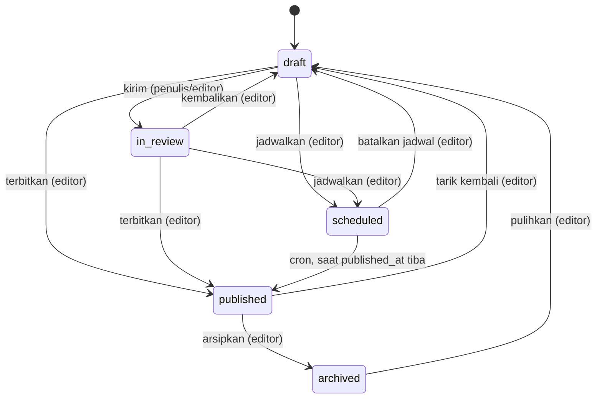

# Artikel (Blog)

Rancangan modul artikel untuk blog publik. **Status: rancangan, belum dibangun.** Menggantikan artikel contoh statis di halaman `/blog` ([F-027](https://gitlab.com/databiota-fredd/frontend/-/blob/development/docs/11-decisions/decision-log.md)): artikel dikelola dari menu di dashboard, disimpan di database, dan dibaca website lewat API publik. Sisi tampilan: [frontend ui/articles.md](https://gitlab.com/databiota-fredd/frontend/-/blob/development/docs/06-domain-guides/ui/articles.md).

## Tujuan dan batas

| Termasuk | Tidak termasuk (v1) |
|---|---|
| Tulis, simpan draf, kirim untuk ditinjau, terbitkan, jadwalkan, tarik kembali, arsipkan | Komentar pembaca, reaksi, penghitung tayangan |
| Kategori, artikel unggulan, sampul, kredit sampul, SEO per artikel | Tag bebas, seri artikel, pencarian teks penuh |
| Artikel tulis sendiri dan kartu **liputan media** yang menaut ke situs lain | Terjemahan (website Indonesia dulu, [F-015](https://gitlab.com/databiota-fredd/frontend/-/blob/development/docs/11-decisions/decision-log.md)) |
| Unggah gambar untuk sampul dan isi artikel | Galeri media bersama, edit gambar, video |
| Riwayat revisi dan pemulihan | Berlangganan email (kotak "Dapatkan pembaruan" disembunyikan sampai ada penyedia email) |

## Siapa yang mengelola

Artikel milik Fluctuz sebagai produk, **bukan milik workspace pelanggan**. Karena itu peran `admin` / `form_editor` / `reviewer` ([security-model.md](../05-security-and-access/security-model.md#peran)) tidak dipakai; admin workspace pelanggan tidak boleh menerbitkan di blog Fluctuz.

Dipakai satu kolom baru `users.platform_role` (null untuk pengguna biasa):

| Peran platform | Boleh |
|---|---|
| `content_author` | Membuat artikel, mengubah dan menghapus **draf milik sendiri**, mengirim untuk ditinjau, mengunggah gambar |
| `content_editor` | Semua milik penulis, ditambah mengubah artikel siapa pun, menerbitkan, menjadwalkan, menarik, mengarsipkan, menyematkan, mengelola kategori |

- Peran platform **tidak bisa diberikan lewat API atau UI**; diberikan lewat CLI (`create-user --platform-role` dan perintah `set-platform-role`), sama seperti pengguna pertama pada irisan 1 auth. Mencegah eskalasi dari akun pelanggan.
- Diterapkan sebagai dependency FastAPI `require_platform_role("content_author")` / `("content_editor")` (editor otomatis lolos cek penulis). Frontend menyembunyikan menu, backend yang menolak.
- `MeResponse.user` mendapat field `platform_role` agar dashboard tahu apakah menu **Konten** ditampilkan.
- Pengguna tanpa workspace tetap bisa punya peran platform (staf Fluctuz); layout dashboard sudah harus menangani `memberships` kosong.

## Siklus status



| Status | Terlihat di web publik | Catatan |
|---|---|---|
| `draft` | tidak | Bisa diubah penulisnya dan editor |
| `in_review` | tidak | Penulis tidak bisa mengubah lagi sampai dikembalikan |
| `scheduled` | tidak | `published_at` di masa depan; job cron `articles.publish_due` berjalan tiap menit |
| `published` | ya, bila `published_at <= now()` | |
| `archived` | tidak (404) | Tidak dihapus; URL lama menjadi 404 |

Tidak ada hapus permanen lewat API. `DELETE /articles/{id}` hanya boleh untuk **draf** yang belum pernah terbit (karena belum punya URL publik); sisanya diarsipkan.

## Model data

Tabel di luar konvensi tenant: **tidak punya `workspace_id`** (data platform). Konvensi lain di [data-model.md](../04-database/data-model.md#konvensi) tetap berlaku (UUID v7, `created_at`/`updated_at`, enum `text` + `CHECK`).

### `articles`

| Kolom | Tipe | Catatan |
|---|---|---|
| `id` | uuid | |
| `kind` | text | `post` (isi di Fluctuz) atau `external` (liputan media, menaut keluar) |
| `status` | text | `draft`, `in_review`, `scheduled`, `published`, `archived` |
| `slug` | text, unik | Huruf kecil, angka, tanda hubung, 3–80 karakter; Bahasa Indonesia boleh. **Terkunci setelah terbit pertama kali** (lihat [Slug](#slug)) |
| `title` | text | 5–140 karakter |
| `excerpt` | text | 20–240 karakter; dipakai di kartu dan `meta description` |
| `body_md` | text | Markdown GFM; wajib untuk `post`, kosong untuk `external`; maksimum 100.000 karakter |
| `category_id` | uuid | FK `article_categories`, wajib saat terbit |
| `cover_media_id` | uuid | FK `article_media`, wajib saat terbit |
| `cover_alt` | text | Teks alternatif sampul, wajib saat terbit |
| `cover_credit` | text, null | Kredit/lisensi gambar, tampil di bawah sampul di halaman artikel |
| `cover_focus_y` | smallint | 0–100, posisi vertikal potong gambar di kartu (default 50); menggantikan `center 35%` yang tertulis di CSS |
| `byline` | text | Default `Tim Fluctuz`; nama tampilan penulis. Email dan nama akun tidak pernah keluar ke publik |
| `external_url` | text, null | Wajib untuk `external`, harus `https://` |
| `source_name` | text, null | Wajib untuk `external` (mis. `Bloomberg Technoz`), tampil sebagai label di sampul kartu |
| `featured_at` | timestamptz, null | Diisi saat disematkan; sematan dicabut dengan mengosongkan |
| `seo_title` | text, null | Opsional, maks 70; default `title` |
| `seo_description` | text, null | Opsional, maks 160; default `excerpt` |
| `read_minutes` | smallint | Dihitung server saat simpan: kata ÷ 200, minimal 1; 0 untuk `external` |
| `published_at` | timestamptz, null | Tanggal tampil **dan** waktu jadwal. Editor boleh mengubahnya (mis. liputan lama 10 Agu 2023) |
| `author_id` | uuid | FK `users`, pembuat; tidak dibuka ke publik |
| `version` | integer | Naik tiap simpan; dipakai untuk [kunci optimistis](#penyuntingan-bersamaan) |
| `created_at`, `updated_at` | timestamptz | |

Indeks: `UNIQUE (slug)`; `(status, published_at DESC)` untuk daftar publik; `(category_id, published_at DESC)`; `(featured_at DESC) WHERE featured_at IS NOT NULL`.

`CHECK` basis data menjaga yang bisa dijaga di level baris: `kind = 'external'` ⇒ `external_url` dan `source_name` terisi dan `body_md` kosong; `status IN ('scheduled','published')` ⇒ `published_at` terisi. Kelengkapan lain (sampul, kategori, alt) diperiksa service saat terbit supaya draf boleh belum lengkap.

### `article_categories`

| Kolom | Catatan |
|---|---|
| `id`, `slug` (unik), `name` | Contoh: Panduan Lapangan, Produk, Riset & Akademik, Produk Baru, Liputan Media |
| `icon` | Kunci dari daftar tetap (`sparkle`, `clock`, `shield`, …) yang dipetakan frontend ke SVG; bukan SVG dari pengguna |
| `position` | Urutan di menu kategori |

Kategori bisa diubah dan diurutkan editor; tidak bisa dihapus selama masih dipakai artikel (`409 conflict`). Seed awal: lima kategori di atas.

### `article_media`

| Kolom | Catatan |
|---|---|
| `id`, `uploaded_by` | |
| `object_key` | `articles/{yyyy}/{uuid}` + akhiran rendisi |
| `width`, `height`, `size_bytes`, `content_type` | Setelah diproses (selalu `image/webp`) |
| `created_at` | |

Rendisi disimpan sekaligus saat unggah: `card` (lebar 800) dan `full` (lebar 1600). Lihat [Media](#media).

### `article_revisions`

| Kolom | Catatan |
|---|---|
| `article_id`, `version`, `snapshot` JSONB (judul, excerpt, body_md, metadata), `status_from`, `status_to`, `actor_id`, `created_at` | |

Satu baris dibuat saat **perubahan status** (kirim, terbitkan, tarik, arsipkan, jadwalkan) dan saat editor menekan "Simpan versi". Simpan otomatis tidak membuat revisi. Disimpan 50 terakhir per artikel; sisanya dihapus oleh cron. `POST /articles/{id}/revisions/{rev}/restore` menyalin snapshot ke draf (status tidak berubah).

### `audit_logs`

Tabel yang ada mewajibkan `workspace_id`. Aksi platform (terbit, tarik, arsip, hapus draf, ubah kategori) dicatat di tabel yang sama dengan **`workspace_id` nullable** dan `target` berupa `article:<id>`.

## Endpoint

Semua di bawah `/api/v1`, mengikuti [format standar](../03-api/api-conventions.md#format-respons). Modul `app/modules/articles/` dan `app/api/v1/articles/` (aturan [pasangan folder](../14-agent-guides/agent-guidelines.md)). Ringkasan juga ada di [endpoints.md](../03-api/endpoints.md#artikel).

### Publik (tanpa login, dipakai server Next.js)

| Method | Path | Keterangan |
|---|---|---|
| GET | `/public/articles` | Daftar artikel `published` dan `published_at <= now()`. Filter `category=<slug>`, `featured=true`, `kind`; urut `-published_at`; pagination cursor (`limit` default 12, maks 50) |
| GET | `/public/articles/{slug}` | Satu artikel `post`; `404` untuk draf, terjadwal, arsip, `external`, dan slug tak dikenal |
| GET | `/public/article-categories` | Kategori yang punya minimal satu artikel terbit, beserta jumlahnya |

Bentuk item daftar (`ArticleCard`):

```json
{
  "slug": "mengenal-agen-ai-fluctuz",
  "kind": "post",
  "title": "Mengenal Agent AI Fluctuz: cara kerja di balik percakapan",
  "excerpt": "…",
  "category": { "slug": "produk", "name": "Produk", "icon": "sparkle" },
  "cover": { "card_url": "/media/articles/2026/….w800.webp", "alt": "…", "focus_y": 35 },
  "published_at": "2026-11-13T02:00:00Z",
  "read_minutes": 6,
  "external_url": null,
  "source_name": null
}
```

Detail (`ArticleDetail`) menambah `body_md`, `cover.full_url`, `cover.width/height`, `cover.credit`, `byline`, `seo_title`, `seo_description`, `updated_at`. `id`, `author_id`, `status`, `version` tidak pernah ada di respons publik.

Header: `Cache-Control: public, max-age=60, stale-while-revalidate=600`. Endpoint publik tidak butuh CSRF (hanya GET) dan masuk rate limit per IP yang sama dengan `public/leads`, dengan batas lebih longgar.

### Pengelolaan (login + peran platform)

| Method | Path | Peran | Keterangan |
|---|---|---|---|
| GET | `/articles` | penulis | Daftar; penulis hanya melihat milik sendiri, editor semua. Filter `status`, `category_id`, `q` (judul), `mine=true`; cursor |
| POST | `/articles` | penulis | Buat draf (hanya `kind` dan `title` wajib); respons `200` berisi artikel (tanpa `201`, seperti respons lain) |
| GET | `/articles/{id}` | penulis (milik sendiri) / editor | Semua field, termasuk `version` |
| PATCH | `/articles/{id}` | penulis (draf milik sendiri) / editor | Body menyertakan `version`; tidak cocok → `409 version_conflict` |
| DELETE | `/articles/{id}` | penulis (draf sendiri) / editor | Hanya draf yang belum pernah terbit |
| POST | `/articles/{id}/submit` | penulis | `draft` → `in_review` |
| POST | `/articles/{id}/return` | editor | `in_review` → `draft`, body `{ "note": "…" }` (catatan untuk penulis) |
| POST | `/articles/{id}/publish` | editor | Terbit sekarang; body opsional `{ "published_at": "…" }` |
| POST | `/articles/{id}/schedule` | editor | Body `{ "published_at": "…" }`, harus di masa depan |
| POST | `/articles/{id}/unpublish` | editor | `published`/`scheduled` → `draft` |
| POST | `/articles/{id}/archive`, `/restore` | editor | |
| PUT | `/articles/{id}/featured` | editor | Body `{ "featured": true\|false }` |
| GET | `/articles/{id}/revisions` | penulis (milik sendiri) / editor | |
| POST | `/articles/{id}/revisions/{rev}/restore` | editor | |
| POST | `/article-media` | penulis | `multipart/form-data`, satu berkas; respons berisi `id`, URL rendisi, ukuran |
| GET, POST | `/article-categories` | GET penulis, POST editor | |
| PATCH, DELETE | `/article-categories/{id}` | editor | |

Aksi status memakai endpoint terpisah (bukan `PATCH status`) agar tiap transisi punya aturan peran, validasi kelengkapan, dan catatan audit sendiri.

### Kode error

| Code | HTTP | Kapan | `field` |
|---|---|---|---|
| `slug_taken` | 409 | Slug sudah dipakai artikel lain | `slug` |
| `slug_reserved` | 422 | Slug termasuk daftar terlarang | `slug` |
| `slug_locked` | 409 | Mengubah slug artikel yang pernah terbit | `slug` |
| `version_conflict` | 409 | `version` di body bukan versi terkini; frontend memuat ulang artikel | `null` |
| `invalid_transition` | 409 | Transisi status tidak diizinkan dari status sekarang | `null` |
| `article_incomplete` | 422 | Terbit/jadwal tapi ada yang kurang; `errors[]` berisi satu item per field (`cover_media_id`, `cover_alt`, `category_id`, `excerpt`, `body_md`, …) | terisi |
| `schedule_in_past` | 422 | `published_at` jadwal sudah lewat | `published_at` |
| `media_too_large` | 413 | Berkas melebihi 5 MB | `file` |
| `media_unsupported` | 422 | Bukan JPEG/PNG/WebP atau isi berkas tidak cocok dengan tipenya | `file` |
| `category_in_use` | 409 | Hapus kategori yang masih dipakai | `null` |

Pesan Bahasa Indonesia ditulis di `app/modules/articles/errors.py`. `forbidden` (umum) dipakai saat peran tidak cukup atau penulis menyentuh artikel orang lain.

## Slug

- Dibuat otomatis dari judul (huruf kecil, tanpa aksen, spasi menjadi `-`); bisa diubah selama artikel **belum pernah terbit**. Pembuatan dilakukan di backend (satu fungsi `slugify`); frontend tidak menyalin logikanya dan hanya mengusulkan slug dari respons server.
- Setelah terbit pertama kali slug terkunci (`slug_locked`), karena URL sudah diindeks dan dibagikan. Ganti slug berarti arsipkan lalu buat ulang. *Pembatasan sadar:* tabel pengalihan (301) ditunda; naikkan bila editor sering perlu ganti slug.
- Slug terlarang (bentrok dengan route Next.js di bawah `/blog`): `category`, `page`, `feed`, `rss`, `new`, `preview`, dan nama file seperti `sitemap`. Daftar ada di satu konstanta di modul.

## Media

- Unggah lewat `POST /article-media` (bukan URL bertanda tangan langsung ke bucket): server perlu memeriksa isi berkas.
- Validasi: ukuran ≤ 5 MB, tipe dari **isi berkas** (magic bytes), bukan dari nama atau header; hanya JPEG, PNG, WebP. **SVG dan GIF ditolak** (SVG bisa memuat skrip). Dimensi minimum 800 px lebar dan maksimum 8000 px.
- Pemrosesan (Pillow, lewat `run_in_threadpool`): hapus EXIF (lokasi dan perangkat tidak ikut terbit), konversi ke WebP, buat rendisi `card` 800 px dan `full` 1600 px, simpan `width`/`height`.
- Bucket: **awalan publik terpisah** dari bucket privat foto laporan ([security-model.md](../05-security-and-access/security-model.md#berkas)). Isinya memang untuk umum, dan URL bertanda tangan berumur 10 menit akan merusak `og:image` dan cache. Dilayani di `/media/…` lewat Caddy dengan `Cache-Control: public, max-age=31536000, immutable`; nama berkas memuat UUID sehingga tidak pernah ditimpa.
- Gambar di dalam isi artikel memakai Markdown ``; renderer hanya menerima URL `/media/` atau `https://` dengan `alt` terisi.
- Berkas tanpa rujukan (diunggah tapi tidak terpakai) **tidak dibersihkan otomatis** di v1. *Pembatasan sadar:* tambah cron pembersih bila penyimpanan membengkak.

## Markdown dan keamanan konten

- Isi disimpan sebagai Markdown mentah dan **tidak pernah di-render menjadi HTML di backend**; dirender di Next.js dengan HTML mentah dimatikan dan daftar elemen yang diizinkan (heading, paragraf, daftar, tabel, kutipan, kode, tautan, gambar). Konten tulisan staf pun tidak dipercaya sepenuhnya: akun staf bisa diretas, dan XSS di domain yang sama membawa cookie sesi dashboard.
- Tautan keluar diberi `rel="noopener noreferrer"`; skema selain `https:`, `mailto:`, dan tautan relatif ditolak.
- `external_url` divalidasi `https://` di server, dan di web dibuka di tab baru dengan `rel="noopener noreferrer"`.
- JSON-LD `Article` dibangun dari field terstruktur, bukan dari teks bebas.

## Penyuntingan bersamaan

Dua orang menyunting artikel yang sama tidak dikunci; yang menyimpan belakangan mendapat `409 version_conflict` dan UI menawarkan memuat ulang (perubahannya tetap ada di editor untuk disalin). Cukup untuk tim konten kecil; tidak ada penyuntingan kolaboratif waktu nyata.

## Penerbitan dan cache web

1. `publish` / cron `articles.publish_due` mengubah status dan menulis revisi dan audit dalam satu transaksi.
2. Setelah commit, backend memanggil situs web agar cache artikel dibuang (lihat [frontend ui/articles.md](https://gitlab.com/databiota-fredd/frontend/-/blob/development/docs/06-domain-guides/ui/articles.md#cache-dan-penerbitan)): `POST` ke alamat internal Next.js dengan rahasia bersama (`REVALIDATE_SECRET`). Alamat itu **tidak boleh bisa dijangkau dari internet** (Caddy menolak path-nya). Kegagalan panggilan hanya dicatat di log; halaman tetap menjadi segar sendiri oleh masa berlaku cache (10 menit).
3. Pemanggilan dijalankan sebagai job arq (dengan percobaan ulang), bukan di dalam request, agar editor tidak menunggu.

## Seed dan pemindahan dari artikel contoh

- Produksi dimulai **kosong**. Seed (`09-seeding`) hanya membuat lima kategori dan akun staf; kedua belas kartu contoh dari desain tidak masuk produksi (judul, tanggal, dan sampulnya contoh; lisensi gambar tidak jelas).
- Untuk development dan staging ada fixture `articles` berisi kartu contoh agar tampilan bisa dilihat; ditandai lewat nama fixture, bukan kolom di tabel.
- Kartu Bloomberg Technoz adalah kasus `kind = external` pertama. **Izin tertulis** untuk memuat logo/judul media tetap berlaku ([F-017](https://gitlab.com/databiota-fredd/frontend/-/blob/development/docs/11-decisions/decision-log.md)).

## Pengerjaan (irisan)

| Irisan | Isi | Selesai bila |
|---|---|---|
| 1 | Migrasi (`articles`, `article_categories`, `article_media`, `article_revisions`, `users.platform_role`, `audit_logs.workspace_id` nullable), peran platform, CLI, seed kategori | Staf bisa dibuat lewat CLI dan `MeResponse` membawa `platform_role` |
| 2 | CRUD, transisi status, kunci versi, aturan kelengkapan, endpoint publik | Artikel dibuat dan diterbitkan lewat API, dan terbaca di `/public/articles` |
| 3 | Unggah media (validasi, WebP, rendisi), awalan bucket publik, `/media` di Caddy | Sampul tampil di kartu |
| 4 | Revisi dan pemulihan, kategori CRUD, sematan | |
| 5 | Cron jadwal, job revalidasi, pemanggilan internal | Artikel terjadwal terbit tanpa campur tangan dan web langsung segar |

Tiap irisan disertai tes (peran, transisi, validasi media dengan berkas palsu, `404` untuk non-terbit).

## Pertanyaan terbuka

1. **Editor tulisan:** Markdown dengan pratinjau dipilih karena paling sederhana dan aman. Bila penulis non-teknis kesulitan, ganti dengan editor blok (mis. Tiptap) yang tetap menyimpan Markdown; kolom `body_md` tidak berubah.
2. **Siapa saja stafnya** dan apakah perlu alur tinjau dua orang (`in_review`) sejak awal; bila hanya satu-dua editor, status `in_review` bisa dihilangkan dari UI tanpa mengubah model.
3. **Penyedia email** untuk berlangganan (kotak di desain Blog): ditunda, butuh keputusan penyedia, persetujuan (opt-in), dan tautan berhenti.
4. **Pengalihan slug** (301) bila artikel sering diganti slug-nya.
5. **Bahasa:** artikel berbahasa Inggris/Arab menunggu keputusan [F-015](https://gitlab.com/databiota-fredd/frontend/-/blob/development/docs/11-decisions/decision-log.md); tambah kolom `language` bila dimulai.
6. **Penyimpanan media publik:** bucket/awalan dan domain `/media` perlu disepakati dengan `infra` (R2 dengan domain khusus atau lewat Caddy).
