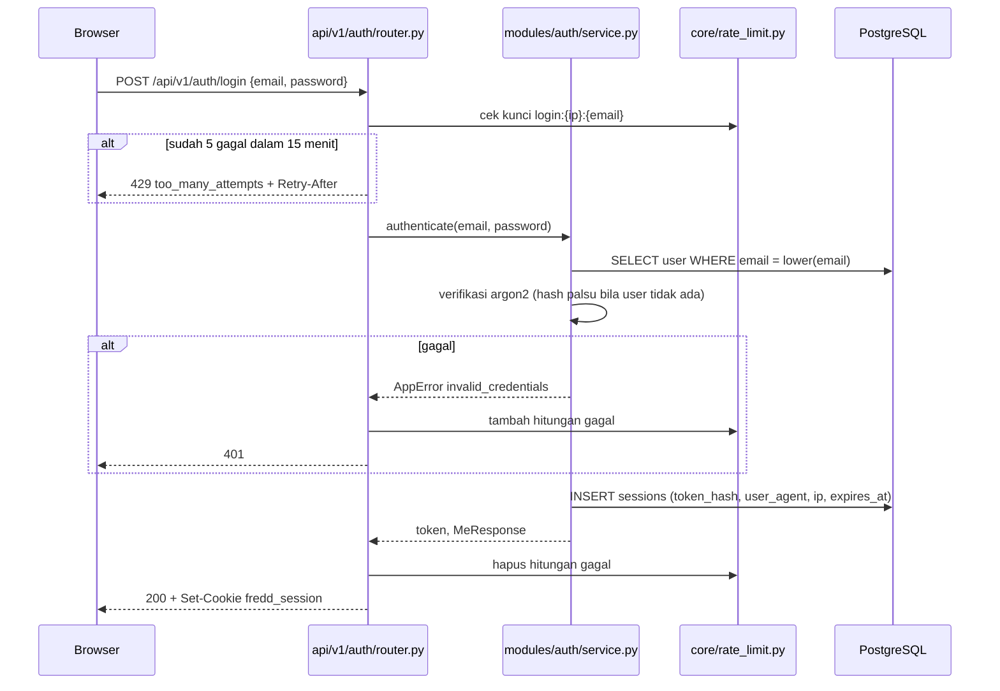

# Auth

Fitur `auth`: endpoint di `app/api/v1/auth/`, logika di `app/modules/auth/`. Masuk, keluar, sesi, daftar, verifikasi email, reset kata sandi, dan Google. Desain layar: [frontend ui/auth.md](https://gitlab.com/databiota-fredd/frontend/-/blob/development/docs/06-domain-guides/ui/auth.md). Format respons: [api-conventions.md](../03-api/api-conventions.md#format-respons). Model keamanan umum: [security-model.md](../05-security-and-access/security-model.md).

## Irisan pengerjaan

Auth dibangun dalam empat irisan. Setiap irisan bisa dijalankan dan dites sendiri.

| Irisan | Isi | Layar | Butuh |
|---|---|---|---|
| **1. Login** | Masuk email + kata sandi, keluar, cek sesi; user dev dibuat lewat CLI | 01 Masuk | Postgres, Redis (sudah ada) |
| 2. Daftar | Daftar, verifikasi email | 02 Daftar | Pengirim email (SMTP / penyedia) |
| 3. Lupa kata sandi | Minta reset, kata sandi baru, cabut sesi lain | 03–06 | Pengirim email |
| 4. Google | Masuk/daftar dengan Google, wajib SSO per workspace | Tombol Google di 01 dan 02 | OAuth client Google Cloud |

Selama irisan berikutnya belum selesai, elemen UI-nya **disembunyikan** (tombol Google, link "Daftar", link "Lupa kata sandi?"), bukan ditampilkan tanpa fungsi.

## Irisan 1: Login

### Endpoint

| Method | Path | Auth | Body | Sukses | Error |
|---|---|---|---|---|---|
| POST | `/api/v1/auth/login` | publik | `LoginRequest` | `200`, cookie `fredd_session`, `data`: `MeResponse` | `401 invalid_credentials`, `422`, `429 too_many_attempts`, `403 csrf_rejected` |
| POST | `/api/v1/auth/logout` | opsional | – | `200`, `data: null`, cookie dihapus | `403 csrf_rejected` |
| GET | `/api/v1/auth/me` | wajib | – | `200`, `data`: `MeResponse` | `401 not_authenticated` |

`logout` selalu `200` meskipun belum login, agar tombol keluar tidak pernah gagal di sisi pengguna.

### Schema

```python
class LoginRequest(BaseModel):
    email: EmailStr  # dinormalisasi: trim + huruf kecil
    password: str = Field(min_length=1, max_length=128)


class UserOut(BaseModel):
    id: UUID
    email: str
    name: str


class MembershipOut(BaseModel):  # terisi setelah modul workspaces ada
    workspace_id: UUID
    workspace_name: str
    workspace_type: Literal["personal", "organization"]
    role: Literal["admin", "form_editor", "reviewer"]


class MeResponse(BaseModel):
    user: UserOut
    memberships: list[MembershipOut]
```

Login tidak memeriksa aturan kekuatan kata sandi (hanya tidak kosong); aturan kekuatan berlaku saat daftar dan reset.

### Contoh respons

`POST /api/v1/auth/login` berhasil:

```json
{
  "success": true,
  "message": "Berhasil masuk.",
  "data": {
    "user": { "id": "0193a1b2-7c4d-7e8f-9a0b-1c2d3e4f5a6b", "email": "dina@contoh.id", "name": "Dina Admin" },
    "memberships": []
  },
  "errors": [],
  "meta": { "request_id": "01JCX4K7P9Q2W3E5R6T8Y0U1I2", "timestamp": "2026-11-14T03:24:00Z", "pagination": null }
}
```

Header: `Set-Cookie: fredd_session=<token>; HttpOnly; Secure; SameSite=Lax; Path=/; Max-Age=2592000`

Email atau kata sandi salah:

```json
{
  "success": false,
  "message": "Email atau kata sandi salah.",
  "data": null,
  "errors": [{ "code": "invalid_credentials", "message": "Email atau kata sandi salah.", "field": null }],
  "meta": { "request_id": "01JCX5…", "timestamp": "2026-11-14T03:24:05Z", "pagination": null }
}
```

Terlalu banyak percobaan (`429`, header `Retry-After: 840`):

```json
{
  "success": false,
  "message": "Terlalu banyak percobaan masuk. Coba lagi dalam 14 menit.",
  "data": null,
  "errors": [{ "code": "too_many_attempts", "message": "Terlalu banyak percobaan masuk. Coba lagi dalam 14 menit.", "field": null }],
  "meta": { "request_id": "01JCX8…", "timestamp": "2026-11-14T03:26:00Z", "pagination": null }
}
```

### Alur login



### Sesi dan cookie

| Hal | Nilai |
|---|---|
| Nama cookie | `fredd_session` |
| Atribut | `HttpOnly; Secure; SameSite=Lax; Path=/`. Di development `Secure` dimatikan otomatis (HTTP lokal) |
| Token | `secrets.token_urlsafe(32)`; hanya hash SHA-256-nya yang disimpan di `sessions.token_hash` |
| Masa berlaku | 30 hari sejak terakhir dipakai (sliding) |
| Perpanjangan | `last_seen_at` dan `expires_at` diperbarui paling sering sekali per 5 menit per sesi, agar tidak menulis ke database di setiap request |
| Logout | `revoked_at` diisi; cookie dihapus (`Max-Age=0`) |
| Validasi per request | `get_current_user`: cari sesi berdasarkan hash token, `revoked_at IS NULL`, `expires_at > now()`; gagal → `401 not_authenticated` |

### Kata sandi

- Hash **argon2id** lewat `argon2-cffi`, parameter bawaan library (setara rekomendasi OWASP: memori 19–64 MiB, 2–3 iterasi).
- Bila parameter berubah di masa depan, hash diperbarui otomatis saat login berhasil (`check_needs_rehash`).
- Saat email tidak ditemukan, service tetap memverifikasi terhadap hash palsu tetap, agar waktu respons tidak membocorkan email mana yang terdaftar.
- `password_hash` bernilai `null` untuk akun yang hanya memakai Google; login kata sandi untuk akun itu → `invalid_credentials`.

### Rate limit

| Kunci Redis | Batas | Reset |
|---|---|---|
| `rl:login:{ip}:{email}` | 5 kegagalan per 15 menit | Dihapus setelah login berhasil |
| `rl:login:{ip}` | 30 kegagalan per 15 menit | Kedaluwarsa otomatis |

Memakai `INCR` + `EXPIRE` (window tetap). Bila Redis tidak tersedia, login tetap berjalan tanpa rate limit dan kejadian dicatat sebagai warning, agar gangguan Redis tidak mengunci semua pengguna.

### CSRF

Middleware `app/api/middleware/csrf.py` berlaku untuk semua request `POST`, `PUT`, `PATCH`, `DELETE` di bawah `/api/`:

- Header `Origin` wajib ada dan sama dengan `APP_BASE_URL`; bila tidak ada, `Referer` dipakai sebagai cadangan.
- Tidak cocok → `403 csrf_rejected`.
- `/webhooks/*` dikecualikan (diverifikasi dengan tanda tangan).
- Di development, `http://localhost:3000` dan `http://localhost:8080` diizinkan lewat `ALLOWED_ORIGINS`.

### Status irisan 1

Selesai 14 November 2026: 27 tes lulus, diuji di browser (mode native) dan lewat Caddy (mode Docker).

Catatan implementasi: `verify_password` dan `hash_password` dijalankan lewat `asyncio.to_thread` karena argon2 memakai CPU puluhan milidetik dan tidak boleh memblokir event loop.

### Membuat user untuk development

Selama irisan 2 belum ada, user dibuat lewat CLI:

```bash
uv run python -m scripts.create_user --email dina@contoh.id --name "Dina Admin"
# kata sandi ditanyakan secara interaktif (tidak lewat argumen, agar tidak tersimpan di riwayat shell)
```

Perintah ini menolak berjalan bila `ENVIRONMENT=production`.

### Tabel

| Tabel | Kolom | Index / constraint |
|---|---|---|
| `users` | `id` UUID v7 (PK), `email` text, `name` text, `password_hash` text null, `email_verified_at` timestamptz null, `google_sub` text null, `created_at`, `updated_at` | `UNIQUE (email)`; email selalu disimpan huruf kecil; `UNIQUE (google_sub)` |
| `sessions` | `id` UUID v7 (PK), `user_id` → users (on delete cascade), `token_hash` text, `user_agent` text, `ip` inet, `created_at`, `last_seen_at`, `expires_at`, `revoked_at` null | `UNIQUE (token_hash)`; index `(user_id)` |

`email_verified_at` dan `google_sub` dibuat di irisan 1 supaya irisan 2 dan 4 tidak butuh migrasi kolom. UUID v7 dibuat dengan `uuid.uuid7()` bawaan Python 3.14.

Migrasi: `alembic/versions/<tanggal>_create_users_and_sessions_<rev>.py`.

### Letak kode

Mengikuti [struktur kode](../02-architecture/system-architecture.md#struktur-kode).

```
app/
├── main.py                      # pasang middleware, exception handler, router
├── api/
│   ├── router.py                # mount v1 (+ webhooks, devtools nanti)
│   ├── cookies.py               # set_session_cookie(), clear_session_cookie(), read_session_token()
│   ├── deps.py                  # get_db, get_current_user, client_ip
│   ├── responses.py             # ApiResponse[T], ApiErrorResponse, ok()
│   ├── errors.py                # handler AppError, validasi, HTTPException, 500
│   ├── middleware/
│   │   ├── request_id.py
│   │   └── csrf.py
│   └── v1/
│       ├── router.py            # /api/v1 + include system, auth
│       ├── system/router.py     # GET /health
│       └── auth/
│           ├── __init__.py
│           └── router.py        # login, logout, get_me
├── modules/
│   └── auth/
│       ├── __init__.py          # __all__ = ["service", "schemas", "errors"]
│       ├── models.py            # User, Session
│       ├── schemas.py           # LoginRequest, UserOut, MembershipOut, MeResponse
│       ├── repository.py        # get_user_by_email, create_session, get_active_session, revoke_session, touch_session
│       ├── service.py           # login, logout, get_me, resolve_session
│       └── errors.py            # InvalidCredentials, NotAuthenticated, TooManyAttempts, EmailAlreadyRegistered, WeakPassword
├── core/
│   ├── config.py
│   ├── errors.py                # AppError, NotFound, Forbidden, Conflict
│   ├── security.py              # hash_password, verify_password, new_token, hash_token
│   ├── rate_limit.py
│   ├── redis.py
│   ├── logging.py
│   └── time.py
└── db/
    ├── base.py
    ├── session.py
    └── models.py                # from app.modules.auth.models import *  (untuk Alembic)
scripts/
└── create_user.py
tests/
├── unit/core/test_security.py
├── unit/modules/auth/test_service.py
└── api/v1/auth/test_login.py, test_me.py, test_logout.py, test_csrf.py
```

### Kode error

| Code | HTTP | Kapan |
|---|---|---|
| `invalid_credentials` | 401 | Email tidak terdaftar, kata sandi salah, atau akun hanya Google |
| `not_authenticated` | 401 | `/me` tanpa sesi valid |
| `too_many_attempts` | 429 | Batas rate limit login tercapai |
| `csrf_rejected` | 403 | `Origin` tidak cocok |
| `required`, `invalid_email` | 422 | Field login kosong atau email tidak valid |
| `email_already_registered` | 409 | Membuat user dengan email yang sudah ada (CLI sekarang, daftar di irisan 2) |
| `weak_password` | 422 | Kata sandi kurang dari 8 karakter atau tanpa huruf dan angka |

### Tes wajib

| # | Skenario | Harapan |
|---|---|---|
| 1 | Login dengan kredensial benar | 200, format respons standar, cookie terpasang dengan atribut benar, baris `sessions` dibuat |
| 2 | Kata sandi salah vs email tidak terdaftar | Keduanya 401 dengan `message` dan `code` identik |
| 3 | Email dengan huruf besar/spasi | Dinormalisasi dan berhasil login |
| 4 | Percobaan gagal ke-6 untuk IP + email yang sama | 429 dengan header `Retry-After` |
| 5 | `/me` dengan cookie valid | 200 dan `data.user` benar |
| 6 | `/me` tanpa cookie, cookie palsu, sesi dicabut, sesi kedaluwarsa | 401 `not_authenticated` |
| 7 | Logout lalu `/me` | 200, lalu 401 |
| 8 | POST login dengan `Origin` domain lain | 403 `csrf_rejected` |
| 9 | Body bukan JSON / field hilang | 400 / 422 dengan `errors[].field` terisi |
| 10 | Respons error 500 (dipaksa di tes) | Format standar, tanpa detail teknis, `request_id` ada di header dan body |

## Irisan 2: Daftar

| Method | Path | Body | Catatan |
|---|---|---|---|
| POST | `/api/v1/auth/register` | `first_name`, `last_name`, `email`, `organization`, `password`, `accept_terms` | Kata sandi min 8, huruf + angka. Email terdaftar → tetap `200` dengan pesan sama dan email pemberitahuan ke pemilik, agar tidak membocorkan email terdaftar |
| POST | `/api/v1/auth/verify-email` | `token` | Token sekali pakai, 24 jam; sukses langsung membuat sesi |
| POST | `/api/v1/auth/verify-email/resend` | `email` | Rate limit; selalu `200` |

Workspace Perorangan paket Gratis dibuat otomatis setelah verifikasi. Tabel tambahan: `auth_tokens` (lihat [data-model.md](../04-database/data-model.md)).

## Irisan 3: Lupa kata sandi

| Method | Path | Body | Catatan |
|---|---|---|---|
| POST | `/api/v1/auth/password/forgot` | `email` | Selalu `200` dengan pesan sama |
| POST | `/api/v1/auth/password/reset` | `token`, `password` | Token 30 menit, sekali pakai; semua sesi lain dicabut |

## Irisan 4: Google

| Method | Path | Catatan |
|---|---|---|
| GET | `/api/v1/auth/google/login?next=` | Redirect ke Google; `state` dan PKCE disimpan di cookie sementara |
| GET | `/api/v1/auth/google/callback` | Buat atau tautkan user berdasarkan `google_sub` / email terverifikasi, buat sesi, redirect ke `next` |

Endpoint redirect ini tidak mengembalikan JSON (pengecualian format respons) karena dibuka langsung oleh browser. Workspace dengan `require_sso = true` menolak login kata sandi untuk anggotanya.

## Endpoint sesi lain (setelah irisan 1)

| Method | Path | Catatan |
|---|---|---|
| GET | `/api/v1/auth/sessions` | Daftar sesi aktif milik user (halaman Keamanan) |
| DELETE | `/api/v1/auth/sessions/{id}` | Keluarkan sesi lain; tidak bisa menghapus sesi saat ini (pakai logout) |
